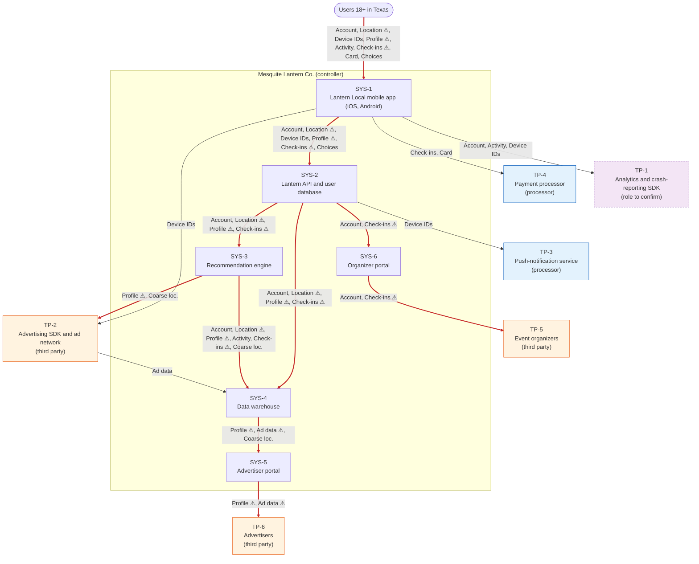

# Data-Flow Map — Lantern Local (as designed, pre-review)

> **FICTIONAL** company, product, vendors, and data. Data is shown by **type** only. Generated by `tools/build_dataflow.py` from [`working/system-description.md`](../working/system-description.md) and [`working/inventory-notes.md`](../working/inventory-notes.md). Edit those files and re-run; do not edit this file by hand.

**How to read it:** arrows show which data groups move between parties. **Red arrows and ⚠** carry data the inventory classifies as Texas "sensitive data" (Tex. Bus. & Com. Code §541.001(29) [S01]). Orange boxes are independent third parties, blue boxes are processors, and the dashed purple box is a party whose role is not yet established. This map shows the **pre-review design**. Changes recommended by the PIA appear in the PIA report.

## Flows (15 arrows)

| From | To | Data elements | Sensitive data? |
|---|---|---|---|
| Users | SYS-1 Lantern Local mobile app (iOS, Android) | DE-01, DE-02, DE-03, DE-04, DE-05, DE-06, DE-07, DE-08, DE-10, DE-11, DE-13, DE-14, DE-15, DE-16, DE-17, DE-18, DE-19, DE-20, DE-23 | **Yes:** DE-07, DE-08, DE-11, DE-14 |
| SYS-1 Lantern Local mobile app (iOS, Android) | SYS-2 Lantern API and user database | DE-01, DE-02, DE-03, DE-04, DE-05, DE-06, DE-07, DE-08, DE-10, DE-11, DE-14, DE-15, DE-18, DE-19, DE-23 | **Yes:** DE-07, DE-08, DE-11, DE-14 |
| SYS-2 Lantern API and user database | SYS-3 Recommendation engine | DE-03, DE-07, DE-08, DE-09, DE-11, DE-14 | **Yes:** DE-07, DE-08, DE-09, DE-11, DE-14 |
| SYS-2 Lantern API and user database | SYS-4 Data warehouse | DE-01, DE-02, DE-03, DE-07, DE-08, DE-09, DE-11, DE-14, DE-15 | **Yes:** DE-07, DE-08, DE-09, DE-11, DE-14 |
| SYS-3 Recommendation engine | SYS-4 Data warehouse | DE-03, DE-07, DE-08, DE-09, DE-11, DE-12, DE-13, DE-14, DE-24 | **Yes:** DE-07, DE-08, DE-09, DE-11, DE-12, DE-14 |
| TP-2 Advertising SDK and ad network | SYS-4 Data warehouse | DE-22 | No |
| SYS-4 Data warehouse | SYS-5 Advertiser portal | DE-12, DE-21, DE-22, DE-24 | **Yes:** DE-12, DE-21 |
| SYS-2 Lantern API and user database | SYS-6 Organizer portal | DE-01, DE-02, DE-14, DE-15 | **Yes:** DE-14 |
| SYS-1 Lantern Local mobile app (iOS, Android) | TP-1 Analytics and crash-reporting SDK | DE-03, DE-13, DE-17, DE-18, DE-19, DE-20 | No |
| SYS-1 Lantern Local mobile app (iOS, Android) | TP-2 Advertising SDK and ad network | DE-17, DE-18, DE-19 | No |
| SYS-3 Recommendation engine | TP-2 Advertising SDK and ad network | DE-12, DE-24 | **Yes:** DE-12 |
| SYS-2 Lantern API and user database | TP-3 Push-notification service | DE-10 | No |
| SYS-1 Lantern Local mobile app (iOS, Android) | TP-4 Payment processor | DE-15, DE-16 | No |
| SYS-6 Organizer portal | TP-5 Event organizers | DE-01, DE-02, DE-14, DE-15 | **Yes:** DE-14 |
| SYS-5 Advertiser portal | TP-6 Advertisers | DE-12, DE-21 | **Yes:** DE-12, DE-21 |

## Data groups used in the map

| Arrow label | Group | Data elements |
|---|---|---|
| Account | Account | DE-01 Name, DE-02 Email address, DE-03 Account ID (internal), DE-04 Date of birth, DE-05 Sign-in provider identifier (Google/Apple), DE-06 Password (stored hashed) |
| Location | Precise location | DE-07 Precise geolocation, foreground, DE-08 Precise geolocation, background (every 15 minutes), DE-09 Location history (stored trail of DE-07/DE-08) |
| Coarse loc. | Coarse location | DE-24 Coarse location (neighborhood or metro area, derived from DE-07/DE-08) |
| Profile | Interests & profile | DE-11 Selected interests (e.g., live music, food, sports), DE-12 Inferred interests and profile |
| Activity | App activity | DE-13 In-app activity (views, taps, saves, searches) |
| Check-ins | Check-ins & tickets | DE-14 Check-in / attendance history (event, place, time), DE-15 Ticket purchase history |
| Card | Card data | DE-16 Payment card data |
| Device IDs | Device & ad IDs | DE-10 Push-notification token, DE-17 Device advertising ID, DE-18 Device information (model, OS, app version), DE-19 IP address, DE-20 Crash and diagnostic logs |
| Ad data | Segments & ad data | DE-21 Audience segment membership, DE-22 Ad interaction data (impressions, clicks) |
| Choices | Choices | DE-23 Permission and preference records (location permission state, marketing opt-in, ad-tracking choice) |

## Observations for the PIA (facts from the map; assessed in S7)
- **10 of 15 flows carry sensitive data.** Sensitive data leaves Mesquite Lantern's own systems on these flows: SYS-3→TP-2, SYS-6→TP-5, SYS-5→TP-6.
- **Embedded SDKs (TP-1 analytics, TP-2 ad network) receive data directly from the app**, not through Mesquite Lantern's servers, so Mesquite Lantern's backend controls do not apply to those flows.
- **TP-1's role (processor or third party) is not stated in the design.** Under Texas law, a processor acts "on behalf of a controller" (§541.001(23) [S01]) and must be under contract (§541.104(b) [S01]).

_Independent educational exercise. Fictional organization and data. Not legal advice._
