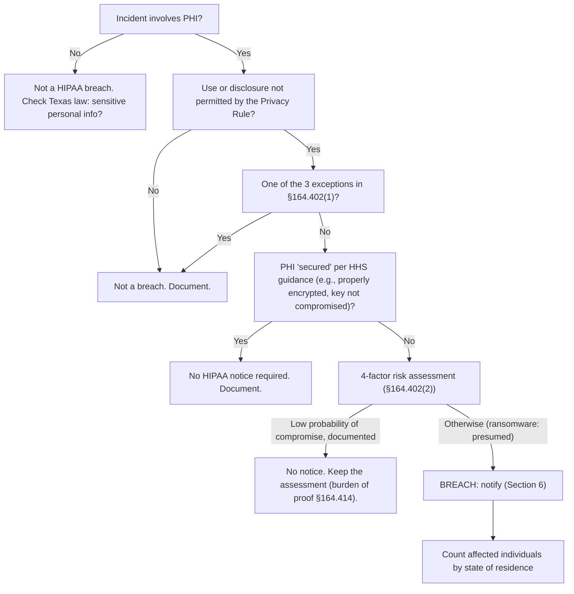

# Incident Response Playbook — Agarita Family Medicine

**Organization:** Agarita Family Medicine, P.A. *(fictional)* · **Owner:** Privacy Officer (Practice Administrator), with the Security Officer (IT Manager)
**Prepared by:** Brittany Green, Privacy Analyst · **Version:** 1.0 DRAFT, 2026-11-03 · **Status:** Severity levels **PROPOSED — Brittany to decide**

> _Independent educational exercise. Fictional organization; roles only, no real people or contact details. Not legal advice. Legal sources: [source register](../sources/source-register.md)._

---

## 1. Purpose and scope
- **Why this exists:** HIPAA requires the clinic to "implement policies and procedures to address security incidents," and to "identify and respond to suspected or known security incidents; mitigate, to the extent practicable, harmful effects…; and document security incidents and their outcomes" (45 CFR §164.308(a)(6) [S02]).
- **What counts as an incident:** a **security incident** is "the attempted or successful unauthorized access, use, disclosure, modification, or destruction of information or interference with system operations in an information system" (§164.304 [S02]). This playbook also covers **privacy incidents**: any suspected impermissible use or disclosure of protected health information (PHI), electronic or not.
- **Framework:** NIST SP 800-61 Rev. 3, which organizes incident response around the CSF 2.0 Functions: **Govern, Identify, and Protect** prepare for incidents; **Detect, Respond, and Recover** handle them; and lessons learned feed the **Improvement** category (ID.IM) [S09, Executive Summary and Table 1].

## 2. Roles

| Role | Who (fictional role) | Responsibilities |
|----------------|------------------------------|-------------------------------------------------------|
| **Incident Commander** | IT Manager / Security Officer | Runs the response; containment and recovery decisions; keeps the incident log |
| **Privacy Lead** | Privacy Analyst | Starts the **breach clock**; leads the breach risk assessment; drafts notices; tracks HIPAA and Texas deadlines |
| **Notification decision-maker** | Practice Administrator / Privacy Officer | Approves the breach determination and all external notices |
| **Clinical lead** | Medical Director | Patient-safety decisions (downtime procedures, diverting patients) |
| **MSP incident lead** | Managed IT provider (business associate) | Technical investigation and restoration; must report breaches it discovers (§164.410 [S01]) |
| **Breach coach** | Outside counsel through the cyber insurer | Legal privilege, regulator strategy, forensics engagement |
| **Communications** | Practice Administrator (delegate) | Staff, patient, and media statements. **Only approved statements** |
| **Billing liaison** | Billing manager | Contact with the billing company (business associate) |

**Contact tree:** the notifying staff member → Incident Commander → Privacy Lead and Privacy Officer → (SEV-1/2) Medical Director, MSP, insurer hotline → breach coach. *(Phone numbers and on-call schedules are kept in the clinic's internal copy, not here.)*

## 3. Severity levels (PROPOSED — Brittany to decide)

| Level | Criteria (any one) | Initial response |
|----------|-----------------------------------------------------------------|-------------------------|
| **SEV-1 Critical** | Ransomware or extortion; confirmed or claimed **exfiltration** of PHI; systems needed for patient care down; likely 500+ individuals | Full team within **1 hour**; notify insurer; consider law enforcement; breach clock starts |
| **SEV-2 High** | Suspected unauthorized access to PHI systems; compromised account with PHI access; likely 50–499 individuals | Team within **4 hours**; breach clock starts |
| **SEV-3 Moderate** | PHI sent to the wrong recipient (e.g., misdirected fax or email), under 50 individuals; lost encrypted device | Privacy Lead same business day |
| **SEV-4 Low** | Security event with no PHI involved (e.g., blocked phishing, malware quarantined) | IT handles; logged weekly |

Severity can go up or down as facts develop. Every change is logged with a reason.

## 4. Response phases

### 4.1 Detect (CSF: DE.CM Continuous Monitoring, DE.AE Adverse Event Analysis) [S09]
- [ ] Staff report anything suspicious to IT immediately (ransom notes, files that won't open, unusual logins).
- [ ] IT confirms whether it is an incident and assigns an initial severity.
- [ ] **Privacy Lead records the discovery date.** Under HIPAA, a breach is "treated as discovered" on "the first day on which such breach is known to the covered entity, or, by exercising reasonable diligence would have been known," including knowledge by any workforce member or agent (§164.404(a)(2) [S01]). **Deadlines run from this date, not from when the investigation ends.**

### 4.2 Respond (CSF: RS.MA Incident Management, RS.AN Incident Analysis, RS.CO Incident Response Reporting and Communication, RS.MI Incident Mitigation) [S09]
- [ ] **Contain:** isolate affected systems; disable compromised accounts; **do not wipe or rebuild** before evidence is preserved.
- [ ] **Preserve evidence:** logs, ransom note, affected-system images (MSP and forensics).
- [ ] **Call the insurer hotline** and engage the breach coach. Forensics goes through counsel.
- [ ] **Law enforcement:** consider reporting to the FBI. If an official states that notice would impede an investigation, follow §164.412 [S01]: delay for the period in a written statement, or up to 30 days for an oral statement that is documented. *(Texas: §521.053(d) [S04, S07].)*
- [ ] **Scope the data:** which systems, which data types, which patients, and their **state of residence**.
- [ ] **Business associates:** if the incident is at or through the MSP or billing company, get their written notice. They must notify the clinic within 60 days of their discovery and identify affected individuals "to the extent possible" (§164.410(b)–(c) [S01]).
- [ ] **Breach determination** (Section 5) and **notifications** (Section 6), led by the Privacy Lead and approved by the Privacy Officer.

### 4.3 Recover (CSF: RC.RP Incident Recovery Plan Execution, RC.CO Incident Recovery Communication) [S09]
- [ ] Restore from backups **verified clean**; reset credentials; patch the entry point.
- [ ] Clinical downtime procedures until the EHR and file systems are confirmed safe.
- [ ] Recovery communications to staff and patients (approved statements only).

### 4.4 Improve (CSF: ID.IM Improvement) [S09]
- [ ] Within 2 weeks of closure: an after-action review covering what happened, what worked, and the gaps.
- [ ] Update this playbook, the risk analysis, training, and vendor contracts.

## 5. Breach determination (HIPAA)

**The legal test:** a "breach" is the acquisition, access, use, or disclosure of PHI in a way the Privacy Rule doesn't permit "which compromises the security or privacy of the protected health information." It is **presumed** to be a breach unless the clinic "demonstrates that there is a low probability that the protected health information has been compromised" through a risk assessment of at least four factors (§164.402 [S01]):
1. the nature and extent of the PHI, including identifiers and re-identification likelihood;
2. the unauthorized person who used it or received it;
3. whether the PHI was actually acquired or viewed;
4. the extent to which the risk has been mitigated.

**Ransomware:** HHS's position is that when ePHI "is encrypted as the result of a ransomware attack, a breach has occurred because the ePHI encrypted by the ransomware was acquired (i.e., unauthorized individuals have taken possession or control of the information)," unless the four-factor assessment shows a low probability of compromise [S03, Q6]. **Ransomware is therefore treated as a presumed breach, even with no evidence of data theft.**

**Burden of proof:** the clinic "shall have the burden of demonstrating that all notifications were made as required… or that the use or disclosure did not constitute a breach" (§164.414 [S01]). **Document every step of the assessment.**

### Decision tree

## 6. Notifications and clocks

**Day 0 = discovery (HIPAA, §164.404(a)(2)) / the date the clinic determines the breach occurred (Texas, §521.053(b)).** Record both dates in the incident log.

| Who | Trigger | Deadline | Source |
|--------------------|--------------------|---------------------------------------------|----------------|
| **Affected individuals** | Breach of unsecured PHI | Without unreasonable delay; **≤ 60 calendar days** after discovery | §164.404(b) [S01] |
| **Affected Texas residents** | Breach of system security involving sensitive personal information (includes health information) | Without unreasonable delay; **≤ 60 days** after determining the breach occurred | §521.053(b) [S05; S04/S07]; §521.002(a)(2)(B) |
| **Texas Attorney General** | **250+ Texas residents** | As soon as practicable; **≤ 30 days**; electronic form | §521.053(i) [S06]; [S08] |
| **HHS (Secretary)** | **500+ individuals** | At the same time as individual notice, via the HHS website | §164.408(b) [S01] |
| **HHS (Secretary)** | **Under 500 individuals** | Log; submit **within 60 days after the end of the calendar year** | §164.408(c) [S01] |
| **Media** | **More than 500 residents of one state** | **≤ 60 days** after discovery | §164.406 [S01] |
| **Consumer reporting agencies** | **More than 10,000** people notified at one time (Texas) | Without unreasonable delay | §521.053(h) [S07; S04] |
| **Residents of other states** | Breach affects their data | May be notified under their state's law or under Texas §521.053 | §521.053(b-1) [S07; S04] |
| **Covered entity (if the clinic is acting as a business associate)** | N/A for the clinic | — | §164.410 [S01] |

**Content of individual notices (HIPAA):** what happened, with the breach and discovery dates; the types of PHI involved; steps individuals should take; what the clinic is doing; and contact procedures, including a toll-free number, email, website, or postal address. In plain language (§164.404(c) [S01]).

**Law-enforcement delay** pauses these clocks only as allowed by §164.412 [S01] and §521.053(d) [S04, S07].

## 7. Records to keep
- The incident log: timeline, decisions, and who made them
- Discovery and determination dates, with the evidence for each
- The four-factor risk assessment and the breach determination
- Every notice sent, with dates, recipient counts, and methods
- Business associate notices received
- Law-enforcement requests, if any

The clinic carries the burden of proof (§164.414 [S01]), so if it isn't documented, it can't be shown.

## 8. Communication rules
- One approved voice. Staff refer outside questions to the Practice Administrator.
- **No statements about paying or not paying a ransom.**
- Don't speculate about scope ("no patient data was affected") until forensics confirms it.
- External statements are reviewed by the breach coach.

---
_Independent educational exercise. Fictional organization. Not legal advice._
